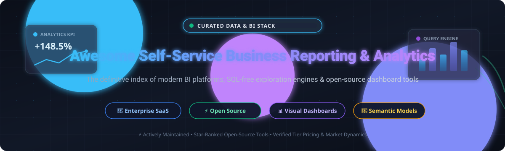
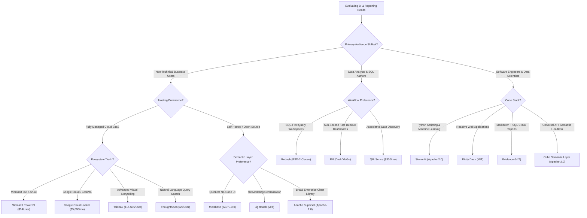

<p align="center">
  
</p>

# 📊 Awesome Self-Service Business Reporting & Analytics 🚀

<p align="center">
  <a href="https://github.com/ishandutta2007/Awesome-Self-Service-Business-Reporting-Analytics/stargazers"></a>
  <a href="https://github.com/ishandutta2007/Awesome-Self-Service-Business-Reporting-Analytics/network/members"></a>
  <a href="https://github.com/sindresorhus/awesome"></a>
  <a href="LICENSE"></a>
</p>

> 🌟 **The Definitive Directory of Self-Service Business Intelligence (BI), Embedded Analytics & Data Reporting Platforms** — comparing commercial SaaS giants and top-starred open-source self-hosted alternatives empowering business analysts, data engineers, and executives to explore data, automate reporting, and build interactive dashboards without SQL.

---

## 📑 Table of Contents

- [🌐 Sector Overview & Market Dynamics](#-sector-overview--market-dynamics)
- [🏢 SaaS & Hosted Commercial Platforms](#-saas--hosted-commercial-platforms)
  - [Commercial BI Comparison Matrix](#-commercial-bi-comparison-matrix)
  - [Platform Deep Dives](#-platform-deep-dives)
- [⚡ Open-Source Self-Hosted Software](#-open-source-self-hosted-software)
  - [Open-Source Solutions by GitHub Stars](#-open-source-solutions-by-github-stars)
  - [Project Deep Dives](#-project-deep-dives)
- [🔍 Architectural Comparison at a Glance](#-architectural-comparison-at-a-glance)
- [💡 Evaluation & Selection Guide](#-evaluation--selection-guide)
- [🤝 Contributing](#-contributing)
- [📄 License](#-license)

---

## 🌐 Sector Overview & Market Dynamics

The global Business Intelligence (BI) and analytics software market is valued at approximately **$35 billion to $38 billion (2025–2026)** and is projected to expand past **$100 billion by the mid-2030s** at an estimated compound annual growth rate (CAGR) of **11% to 15%**.

The sector exhibits **moderate fragmentation with an oligopolistic upper tier**: mega-cap enterprise cloud incumbents (Microsoft Power BI, Salesforce Tableau, and Google Cloud Looker) capture dominant enterprise volume, while intense fragmentation persists across mid-market, dbt-native semantic modeling, and agentic AI analytics startups.

---

## 🏢 SaaS & Hosted Commercial Platforms

Commercial cloud-hosted Self-Service Business Reporting and Analytics suites evaluated across verified starting pricing, free tiers / trial durations, and parent organization valuation or scale.

### 📊 Commercial BI Comparison Matrix

*The table below is sorted in descending order by parent company scale (valuation or annual revenue).*

| Platform | Type / Specialty | Scale (Valuation / Revenue) | Starting Pricing (Specific Paid Tier) | Free Tier Limits / Free Trial Plan | Primary Focus |
|:---|:---|:---:|:---|:---|:---|
| **[Microsoft Power BI](https://powerbi.microsoft.com/)** | Microsoft ecosystem enterprise BI & analytics | **~$3.1 Trillion** *(Microsoft Mkt Cap)* | **$14.00 / user / month** *(Power BI Pro, annual commitment)* | **Free Forever Plan** *(Local desktop report authoring & personal sandbox; online sharing requires Pro license)* + 30-day trial for Pro/PPU | Seamless Microsoft 365, Teams, Excel & Azure integration |
| **[Looker](https://cloud.google.com/looker)** *(Google Cloud)* | Governed semantic modeling & enterprise BI | **~$2.1 Trillion** *(Alphabet Mkt Cap; $2.6B acq.)* | **$5,000.00 / month** *(Standard Edition platform fee; includes 10 Standard + 2 Developer users, +$30–$66/user for added seats)* | **No Free Tier** *(30-day guided Proof-of-Concept / sales sandbox upon request; Looker Studio offers a separate basic free tier)* | Governed LookML single source of truth |
| **[Tableau](https://www.tableau.com/)** *(Salesforce)* | Visual analytics & self-service exploration | **~$280 Billion** *(Salesforce Mkt Cap; $15.7B acq.)* | **$15.00 / user / month** *(Viewer tier; Explorer at $42/user/mo, Creator at $75/user/mo billed annually)* | **Free Forever (Public Only)** *(Tableau Public with unlimited public workbooks, 10 GB storage, no private commercial privacy)* + 14-day full trial | Drag-and-drop visual storytelling & deep charting |
| **[Qlik Sense](https://www.qlik.com/us/products/qlik-sense)** | Associative query engine & cloud analytics | **~$10 Billion** *(Thoma Bravo valuation; $200M+ ARR)* | **$300.00 / month** *(Qlik Cloud Starter, base bundle up to 10 users & 25 GB/year data)* | **30-Day Free Trial** *(Full-featured cloud analytics, up to 5 users and 5 GB data reload cap; no credit card required)* | In-memory associative exploration |
| **[ThoughtSpot](https://www.thoughtspot.com/)** | Search-driven natural language & AI analytics | **~$1.0 Billion** *(Valuation; ~$150M ARR)* | **$25.00 / user / month** *(ThoughtSpot Essentials / Team, billed annually)* | **30-Day Free Trial** *(Full cloud environment access with sample data warehouse connection; no credit card required)* | Natural-language query search without SQL |
| **[Sisense](https://www.sisense.com/)** | Embedded analytics & OEM custom dashboards | **~$1.0 Billion** *(Valuation; ~$140M ARR)* | **$3,330.00 / month** *(Essential Package ~$40,000/year annual minimum contract)* | **14-to-30 Day Free Trial** *(Assisted developer proof-of-concept POC sandbox upon sales consultation; no permanent free tier)* | White-label embedded analytics & API orchestration |
| **[Domo](https://www.domo.com/)** | Full-stack cloud BI, ETL & business apps | **~$350 Million** *(Nasdaq: DOMO; ~$317M ARR)* | **$2,500.00 / month** *(Standard consumption tier starting ~$30,000/year for data credits & unlimited seats)* | **30-Day Free Trial** *(Complete platform trial including Magic ETL, connectors, and unlimited users; no credit card required)* | All-in-one ETL, data lakehouse & BI apps |

---

### 🔎 Platform Deep Dives

#### 🔷 [Microsoft Power BI](https://powerbi.microsoft.com/)
* **Category:** Enterprise Business Analytics  
* **Architecture:** Cloud Service (Azure) + Desktop Client  
* Power BI dominates corporate deployments due to aggressive bundled pricing, native Microsoft Fabric and Office 365 synergy, and rapid DAX modeling capabilities. It allows non-technical users to build dashboards in a familiar Excel-like ribbon environment while supporting complex enterprise tenant administration.

#### 🔷 [Looker (Google Cloud)](https://cloud.google.com/looker)
* **Category:** Enterprise Governed Metrics & Embedded BI  
* **Architecture:** Cloud Native (GCP / Multi-cloud)  
* Looker eliminates data discrepancies by routing all queries through LookML—a version-controlled, centralized data modeling layer. It targets large enterprises where engineering governance must precede dashboard creation, preventing disparate definitions of core company KPIs.

#### 🔷 [Tableau (Salesforce)](https://www.tableau.com/)
* **Category:** Visual Exploration & Business Intelligence  
* **Architecture:** Cloud / Server / Desktop  
* Tableau remains the gold standard for visual data exploration, offering versatile drag-and-drop mechanics, calculated fields, and dashboard aesthetic customization. Best suited for dedicated business analysts and visual data storytellers requiring complex multi-chart coordination.

#### 🔷 [Qlik Sense](https://www.qlik.com/us/products/qlik-sense)
* **Category:** In-Memory Associative Analytics  
* **Architecture:** Qlik Cloud SaaS / Hybrid Client-Managed  
* Powered by the QIX Associative Engine, Qlik Sense exposes data relationships in all directions without forcing pre-aggregated query paths. Analysts can discover unexpected outliers, unassociated rows, and hidden patterns across diverse operational databases.

#### 🔷 [ThoughtSpot](https://www.thoughtspot.com/)
* **Category:** AI-Powered Search Analytics  
* **Architecture:** Cloud Data Warehouse Native  
* ThoughtSpot pioneered search-driven BI, allowing business stakeholders to ask questions in plain English and automatically receive generated visualizations and predictive anomaly breakdowns directly on Snowflake, BigQuery, and Databricks.

#### 🔷 [Sisense](https://www.sisense.com/)
* **Category:** Extensible Embedded Analytics  
* **Architecture:** Cloud / Linux Kubernetes Microservices  
* Sisense delivers complete white-label analytics and customizable SDKs for product teams embedding interactive charts, automated workflows, and custom alerts directly into customer-facing SaaS applications.

#### 🔷 [Domo](https://www.domo.com/)
* **Category:** Operational BI & Low-Code App Platform  
* **Architecture:** Full-Stack Cloud SaaS  
* Domo bundles end-to-end data ingestion (1,000+ connectors), drag-and-drop Magic ETL, real-time alerting, and business intelligence reporting into a single cloud ecosystem for executive and operational teams.

---

## ⚡ Open-Source Self-Hosted Software

Community-governed, self-hosted, and transparent reporting platforms that grant full ownership of your data warehouse connections, security perimeters, and infrastructure budgets.

### 🌟 Open-Source Solutions by GitHub Stars

*The table below is sorted in descending order by current GitHub repository star count.*

| Repository | GitHub Stars Badge | Primary Language / Stack | License | Key Differentiator |
|:---|:---:|:---|:---:|:---|
| **[Apache Superset](https://github.com/apache/superset)** | [](https://github.com/apache/superset/stargazers) | Python / Flask / React / TypeScript | Apache-2.0 | 40+ visualization types, enterprise SQL lab, and native semantic layer |
| **[Metabase](https://github.com/metabase/metabase)** | [](https://github.com/metabase/metabase/stargazers) | Clojure / Java / TypeScript | AGPL-3.0 | Intuitive no-code visual question builder for business teammates |
| **[Streamlit](https://github.com/streamlit/streamlit)** | [](https://github.com/streamlit/streamlit/stargazers) | Python / TypeScript | Apache-2.0 | Fastest way to convert Python scripts and dataframes into shareable web dashboards |
| **[Redash](https://github.com/getredash/redash)** | [](https://github.com/getredash/redash/stargazers) | Python / Flask / React | BSD-2-Clause | Lightweight SQL-first workbench with query sharing, parameters, and scheduled alerts |
| **[Plotly Dash](https://github.com/plotly/dash)** | [](https://github.com/plotly/dash/stargazers) | Python / React / Flask | MIT | Low-code reactive framework for building production analytical web applications |
| **[Cube](https://github.com/cube-js/cube)** | [](https://github.com/cube-js/cube/stargazers) | Rust / TypeScript / Node.js | Apache-2.0 | Universal semantic layer, caching, access control, and SQL/REST/GraphQL APIs |
| **[Evidence](https://github.com/evidence-dev/evidence)** | [](https://github.com/evidence-dev/evidence/stargazers) | JavaScript / Svelte / SQL / Markdown | MIT | Code-first BI using Markdown and SQL for Git-versioned analytical reports |
| **[Lightdash](https://github.com/lightdash/lightdash)** | [](https://github.com/lightdash/lightdash/stargazers) | TypeScript / Node.js / React | MIT (Core) | dbt-native open-source Looker alternative translating YAML metrics into point-and-click BI |
| **[Rill](https://github.com/rilldata/rill)** | [](https://github.com/rilldata/rill/stargazers) | Go / DuckDB / Svelte / TypeScript | Apache-2.0 | Ultra-fast local-to-cloud BI powered by DuckDB with instant sub-second dashboards |

---

### 🛠️ Project Deep Dives

#### 🌟 [Apache Superset](https://github.com/apache/superset)
[](https://github.com/apache/superset/stargazers)  
* **Stack:** Python, Flask, React, TypeScript | **License:** Apache-2.0  
* **Overview:** The flagship open-source business intelligence platform originating from Airbnb. Superset provides a comprehensive SQL IDE (SQL Lab), granular role-based security (RBAC), and 40+ visualization plugins (geospatial deck.gl, Sankey diagrams, heatmaps, and pivot tables). It supports any database connected via SQLAlchemy (PostgreSQL, MySQL, Snowflake, BigQuery, ClickHouse, Trino).
* **Pros:** Enterprise-proven scalability, zero per-seat licensing, vast visualization catalog.
* **Cons:** Substantial DevOps maintenance; multi-container setup (Redis, Celery, Postgres, Gunicorn).

#### 🌟 [Metabase](https://github.com/metabase/metabase)
[](https://github.com/metabase/metabase/stargazers)  
* **Stack:** Clojure, Java, TypeScript | **License:** AGPL-3.0 (Open Source Core)  
* **Overview:** Metabase is the fastest path to self-service data discovery for non-technical teams. Its Question Builder guides non-analysts to filter, aggregate, group, and visualize data without writing a single line of SQL. Automated "X-Rays" generate instant exploratory dashboards for newly connected tables.
* **Pros:** Exceptional user experience, rapid non-technical adoption, single-jar or lightweight Docker deployment.
* **Cons:** Advanced governance, SSO, and granular row-level data permissions require paid Pro/Enterprise tiers.

#### 🌟 [Streamlit](https://github.com/streamlit/streamlit)
[](https://github.com/streamlit/streamlit/stargazers)  
* **Stack:** Python, TypeScript | **License:** Apache-2.0  
* **Overview:** Streamlit turns data scripts into shareable web apps in minutes. By writing pure Python, data scientists and business analysts can render interactive charts (Altair, Plotly, Vega-Lite), data tables, input sliders, and AI agent chat widgets without frontend web development.
* **Pros:** Zero frontend code required; perfect for rapid prototyping, AI/ML exploratory dashboards, and custom analytical tooling.
* **Cons:** Execution model re-runs entire scripts on widget interaction unless cached carefully with `@st.cache_data`.

#### 🌟 [Redash](https://github.com/getredash/redash)
[](https://github.com/getredash/redash/stargazers)  
* **Stack:** Python, Flask, React | **License:** BSD-2-Clause  
* **Overview:** Redash connects directly to dozens of SQL, NoSQL, and API datasources. It enables analysts to write queries with auto-complete, turn outputs into shareable visualizations, arrange them on team dashboards, and configure automated alert triggers for Slack, Webhooks, or Email.
* **Pros:** Simple SQL-centric workflow, lightweight architecture, reliable dashboarding.
* **Cons:** Core maintenance slowed post-Databricks acquisition; primarily community-maintained.

#### 🌟 [Plotly Dash](https://github.com/plotly/dash)
[](https://github.com/plotly/dash/stargazers)  
* **Stack:** Python, React.js, Flask | **License:** MIT  
* **Overview:** Dash is an enterprise-grade framework for building analytical web applications. It binds interactive Plotly charts with reactive Python callback functions, delivering customizable dashboards for quantitative analysis, financial forecasting, and scientific reporting.
* **Pros:** Granular UI layout control, massive charting ecosystem, highly scalable for production analytics.
* **Cons:** Steeper learning curve than Metabase or Superset; requires Python software engineering skills.

#### 🌟 [Cube](https://github.com/cube-js/cube)
[](https://github.com/cube-js/cube/stargazers)  
* **Stack:** Rust, TypeScript, Node.js | **License:** Apache-2.0  
* **Overview:** Cube is a universal semantic layer that bridges raw cloud data warehouses with any frontend reporting tool or custom web application. It handles data modeling, pre-aggregations (caching), access control, and multi-protocol serving via SQL API, REST API, and GraphQL.
* **Pros:** Standardizes enterprise business logic across Tableau, Superset, and internal applications; blazing-fast query acceleration.
* **Cons:** Acts as an analytical middleware rather than a standalone dashboard UI (pairs with Superset, Metabase, or custom frontends).

#### 🌟 [Evidence](https://github.com/evidence-dev/evidence)
[](https://github.com/evidence-dev/evidence/stargazers)  
* **Stack:** JavaScript, Svelte, Markdown, DuckDB | **License:** MIT  
* **Overview:** Evidence is a modern "BI-as-Code" framework. Analysts build reports using Markdown, SQL queries, and interactive data components. Reports compile into ultra-fast static web pages that deploy on GitHub Pages, Vercel, or Netlify, enabling full Git version control, PR code reviews, and automated CI/CD testing for business reporting.
* **Pros:** Fully version-controlled analytics, zero server maintenance for static builds, rapid Svelte-powered rendering.
* **Cons:** Tailored for technical teams comfortable with Git, SQL, and Markdown rather than non-technical drag-and-drop users.

#### 🌟 [Lightdash](https://github.com/lightdash/lightdash)
[](https://github.com/lightdash/lightdash/stargazers)  
* **Stack:** TypeScript, Node.js, React | **License:** MIT (Core)  
* **Overview:** Designed as the open-source alternative to Looker, Lightdash integrates directly into your dbt project repository. Metrics, dimensions, and descriptions defined in your dbt `.yml` models automatically synchronize into an interactive no-code chart explorer for business teammates.
* **Pros:** Eliminates metric synchronization drift; single source of truth declared in code; native dbt semantic integration.
* **Cons:** Hard dependency on a dbt-orchestrated data warehouse; self-hosting requires Kubernetes, PostgreSQL, and storage backends.

#### 🌟 [Rill](https://github.com/rilldata/rill)
[](https://github.com/rilldata/rill/stargazers)  
* **Stack:** Go, DuckDB, Svelte, TypeScript | **License:** Apache-2.0  
* **Overview:** Rill provides real-time, interactive dashboards powered by an embedded DuckDB engine. It bridges the gap between data modeling and operational metric dashboards, enabling instant exploratory slicing and dicing with zero perceptible latency.
* **Pros:** Unmatched exploratory speed, single binary local developer CLI, declarative YAML configuration.
* **Cons:** Optimized for time-series and event telemetry data; smaller community than Superset or Metabase.

---

## 🔍 Architectural Comparison at a Glance

| Solution | Deployment | Primary Stack | Semantic Layer Type | SQL Required for End Users? | Best Suited For |
|:---|:---:|:---:|:---:|:---:|:---|
| **Microsoft Power BI** | Managed Cloud | SaaS / Windows Client | DAX / Tabular Data Models | ❌ No | Microsoft 365 enterprises & Excel-centric workflows |
| **Looker** | Managed Cloud | Multi-cloud SaaS | LookML (Governed Git-backed) | ❌ No | Strict enterprise governance & metrics-first shops |
| **Tableau** | Managed / On-Prem | SaaS / Server / Desktop | Tableau Data Prep / Relations | ❌ No | In-depth visual analytics & presentation dashboards |
| **Qlik Sense** | Managed / Hybrid | SaaS / Windows Server | QIX Associative In-Memory | ❌ No | Exploratory associative analysis across unstructured links |
| **ThoughtSpot** | Managed Cloud | SaaS Native | Search / Live Analytics | ❌ No | Executive & business natural language search |
| **Sisense** | Managed / Kubernetes | SaaS / Linux Containers | Elasticube & Cloud Modeling | ❌ No | SaaS product teams needing white-label embedded BI |
| **Domo** | Managed Cloud | SaaS Native | Magic ETL & Beast Mode | ❌ No | Fast-paced executive dashboards with built-in ETL |
| **Apache Superset** | Self-Hosted / Managed | Python / Flask / React | Virtual Datasets & Metrics | ❌ Optional | Enterprise open-source BI with 40+ visualization types |
| **Metabase** | Self-Hosted / Managed | Clojure / Java / TypeScript | Data Model & Saved Questions | ❌ No | Non-technical business teams seeking self-service questions |
| **Streamlit** | Self-Hosted / Cloud | Python / Web | Python Dataframes & Caching | ⚠️ Scripting | Data scientists building custom interactive data apps |
| **Redash** | Self-Hosted | Python / Flask / React | SQL Query Parametrization | ✅ Yes | SQL-fluent analysts needing quick shared dashboards |
| **Plotly Dash** | Self-Hosted / Cloud | Python / React | Python Reactive Data Structures | ⚠️ Scripting | Engineers creating production-grade analytical web apps |
| **Cube** | Self-Hosted / Cloud | Rust / TypeScript | Universal Semantic Data Schema | ❌ API-Driven | Standardized metrics API layer across multiple frontends |
| **Evidence** | Self-Hosted / Static | JS / Svelte / Markdown | Markdown & SQL-as-Code | ⚠️ Authoring | Engineering-led BI-as-code and Git-reviewed reports |
| **Lightdash** | Self-Hosted / Cloud | TypeScript / React | dbt Semantic YAML Models | ❌ No | Modern data stacks with dbt as the single source of truth |
| **Rill** | Self-Hosted / Cloud | Go / DuckDB / Svelte | Declarative Metrics YAML | ❌ No | Ultra-fast time-series slicing with sub-second response |

---

## 💡 Evaluation & Selection Guide



---

## 🤝 Contributing

Contributions are warmly welcomed! Help make this curated directory the best resource for data teams:

1. **Check for duplicates** — Review the existing tables to verify the tool is not already covered.
2. **Review criteria** — Tools must be actively maintained (commit within the last 12 months) with transparent documentation.
3. **Submit a pull request** — Include the project name, official URL, stack, license, verified pricing or star count, and primary use case.

```bash
# Clone the repository
git clone https://github.com/ishandutta2007/Awesome-Self-Service-Business-Reporting-Analytics.git

# Create a feature branch
git checkout -b feature/add-new-reporting-tool
```

---

## 📄 License

This compilation is licensed under the [Creative Commons Zero v1.0 Universal (CC0 1.0)](LICENSE) Public Domain Dedication. Software projects and registered trademarks referenced remain the property of their respective creators and organizations.

<p align="center">
  ⭐ <b>If you find this curated list valuable for your analytics architecture, please give it a star!</b> ⭐
</p>
